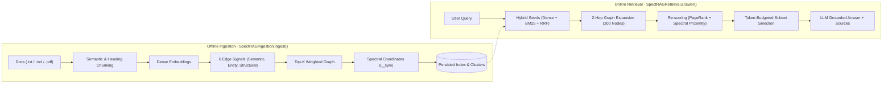
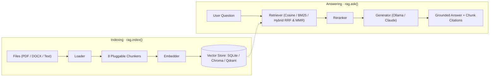
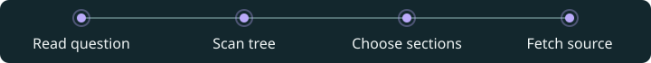
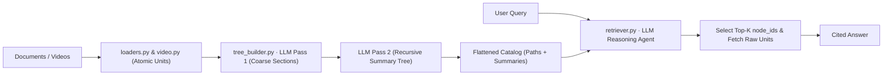
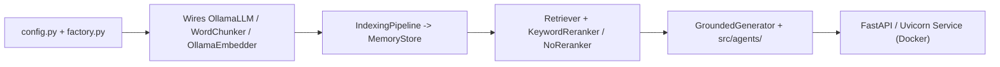
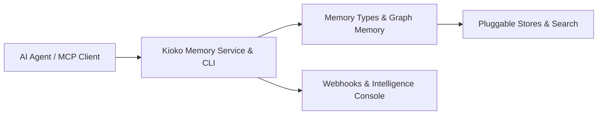
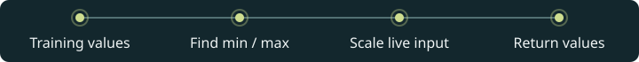
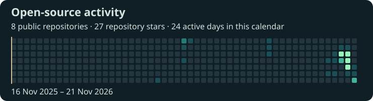

<p align="center"></p>

<p align="center"></p>

## 👨‍💻 About Me

```python
engineer = {
    "name": "Kumar Nishant",
    "role": "Senior ML Engineer & AI Agent Specialist",
    "team": "Rockwell Automation",
    "home": "Pune, India",
    "experience": "10+ years in machine learning and data systems",
    "building": ["tool-using agents", "retrieval pipelines", "long-term memory"],
    "research": "How do we select the right evidence within a token budget?",
}
```

---

## 🛠️ Tech Arsenal

<details open>
<summary><b>Agents and language models</b></summary>

       

</details>

<details open>
<summary><b>Cloud and MLOps</b></summary>

       

</details>

<details>
<summary><b>Programming and ML</b></summary>

       

</details>

<details>
<summary><b>Search, data and monitoring</b></summary>

        

</details>

<details>
<summary><b>Engineering practices</b></summary>

    

</details>

---

## 🚀 Open-Source Work & Individual Architecture Flows

A showcase of my public repositories with the end-to-end execution flow behind each system.

### 1. [SpectraFuse](https://github.com/aion7891/SpectraFuse) — Spectral Graph-Augmented Multi-Hop RAG

Independent Python implementation inspired by *SpectRAG* (`arXiv:2610.36991`), combining multi-signal graph construction, normalized Laplacian spectral coordinates, PageRank re-scoring, and token-budgeted context selection for multi-hop RAG (`v0.2.0`).


<details>
<summary>View architecture diagram</summary>



</details>

---

### 2. [rag-titan](https://github.com/aion7891/rag-titan) — Swiss Army Knife for Local & Cloud RAG

A unified Python RAG library (`v0.11.0`) supporting multiple RAG strategies (`simple`, `adaptive`), 8 chunkers, hybrid RRF/MMR retrieval, and 100% local execution with Ollama or cloud inference with Claude.


<details>
<summary>View architecture diagram</summary>



</details>

---

### 3. [vectorless-rag-lite](https://github.com/aion7891/vectorless-rag-lite) — Reasoning-Based Tree RAG (`novector`)

Minimal, from-scratch vectorless RAG for documents and videos. Replaces vector embeddings and cosine similarity with a hierarchical semantic summary tree navigated by an LLM reasoning agent.



<details>
<summary>View architecture diagram</summary>



</details>

---

### 4. [agent-core-lab](https://github.com/aion7891/agent-core-lab) — Modular Core AI Agent & RAG Service

A containerized laboratory for building core AI agents and grounded RAG pipelines from first principles using a clean factory architecture.


<details>
<summary>View architecture diagram</summary>



</details>

---

### 5. [kioko-docs](https://github.com/aion7891/kioko-docs) — Kioko: Long-Term Memory for AI Agents

Published documentation portal for **Kioko**, covering agent memory types, graph memory, MCP integration, pluggable stores, CLI, console, webhooks, and deployment cookbooks.


<details>
<summary>View architecture diagram</summary>



</details>

---

### 6. Labs & In-Progress Builds



| Repository | Focus | Current State |
|---|---|---|
| [**base-core**](https://github.com/aion7891/base-core) | Hand-built ML utility core (`Rescale.scale_live` min-max scaler on NumPy/Pandas) | Core logic utility |
| [**rex-intelligence**](https://github.com/aion7891/rex-intelligence) | Multi-agent chatbot system to streamline user order requests | Initial architecture scaffold |

---

## 💼 Work History & Enterprise Impact

### Senior ML Engineer & AI Agent Specialist — **Rockwell Automation**
`03/2026 – Present` · `Pune, India`

I build agents for industrial diagnostics and predictive maintenance. My work combines LangGraph and MCP with technical manuals, sensor data and logs. I also develop hybrid search and recommendation systems for industrial parts.

### Senior Data Scientist (MLE) & AI Team Lead — **Demandbase**
`01/2020 – 03/2026` · `Pune, India`

* **Agent Platform Development:** Built and productionized enterprise AI agents using **AWS Bedrock** (Claude, Llama) for automated IT product classification and budget prediction; designed multi-agent orchestration managing specialized sub-agents with **95% reliability**; built LangGraph/LangChain memory components improving context retention by **40%**.
* **LLM Framework & Infrastructure:** Architected large-scale **BERT** classification models achieving **92% F1 score** for IT product identification; built production **MCP (Model Context Protocol)** client systems for server testing and tool discovery; implemented CI/CD MLOps pipelines reducing deployment time from **weeks to hours**; delivered ensemble IT budget regression models (**R² = 0.87**).
* **Technical Leadership:** Led an enterprise AI team of **5+ engineers** shipping production agent capabilities for **Fortune 500** companies; mentoring junior ML engineers and setting standards for code review, testing, and documentation.

### Data Analyst — **Capita IT (Ventura)**
`08/2015 – 01/2020` · `Pune, India`

* Developed foundational ML models and ETL data pipelines that evolved into enterprise AI solutions.
* Built automated standing data systems for the insurance domain using deep learning (**ANN**) achieving **91.4% accuracy**.
* Applied unsupervised learning (**K-means, DBSCAN, LDA**) for product usage segmentation and behavioral analysis.

---

## 🏗️ Flagship Enterprise Systems

| System | Architecture & Tech Stack | Measured Impact |
|---|---|---|
| **Enterprise AI Agent Platform** | Python, AWS Bedrock, LangChain, LangGraph, Docker, Kubernetes, A2A, MCP | **99.5% uptime** across distributed agent infrastructure serving **50+ enterprise clients**; cut manual IT analysis by **80%** |
| **Production LLM Framework** | BERT, Transformers, MLflow, Terraform, AWS EC2/EMR, Prometheus, Grafana | Unified API interface integrating multiple Bedrock models (GPT, Claude, Llama) with full production observability |
| **Agentic Memory Management System** | LangGraph, Vector Databases, Elasticsearch, RAG | Improved response accuracy by **35%** with scalable vector storage handling **10M+ document embeddings** |

---

## 🏆 Achievements, Certifications & Education

| Credential / Recognition | Organization / Institution | Details |
|---|---|---|
| **AWS Machine Learning Specialty** | Amazon Web Services | Industry Certification |
| **Advanced Deep Learning Specialization** | Deep Learning Certification | Specialization |
| **B.Tech in Computer Science (Honors)** | B.K. Birla Institute of Engineering & Technology, Pilani | 2010 – 2014 · 70.6% |
| **Technical Innovation Award** | Demandbase | Led enterprise AI agent platform reducing manual IT analysis by **80%** |
| **International Research Internship** | Polytech, Nantes, France | Selected for advanced AI research internship |
| **Team Excellence ("Pat on Back" ×2)** | Enterprise Recognition | Awarded twice for outstanding automation and AI implementation |

---

## 📈 GitHub activity

[](https://github.com/aion7891?tab=overview)

[Latest contributions](https://github.com/aion7891?tab=overview) · [Explore repositories](https://github.com/aion7891?tab=repositories)

---

## 🤝 Let's Connect

<div align="center">
  <a href="mailto:knish5790@gmail.com">
    
  </a>
  <a href="https://github.com/aion7891">
    
  </a>
  <a href="https://github.com/aion7891?tab=repositories">
    
  </a>

  <br /><br />

  *Architecting production AI agents, graph-augmented retrieval, and long-term agent memory.*

  **Thanks for visiting! Star any repo if you find it useful.**
</div>
