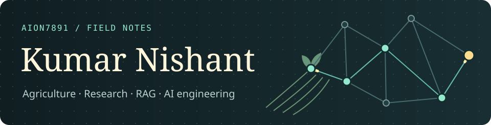

# Hi, I’m Kumar Nishant 👋

Give a model a hundred pages and one question. Which five passages should it read? That question runs through my open-source work. I build Python tools for retrieval and experiment with how agents find and remember information.

## Start with SpectraFuse

I built **SpectraFuse**, an independent Python implementation inspired by the SpectRAG paper. It connects related passages in a weighted graph, then selects evidence for multi-hop questions within a token budget. I published it on PyPI and wrote interactive explainers so you can follow the selection process yourself.

[Explore the code](https://github.com/aion7891/SpectraFuse) · [Read the docs](https://aion7891.github.io/SpectraFuse/) · [Get the package](https://pypi.org/project/spectrafuse/)

## More from my workbench

| Project | What you can try |
| --- | --- |
| [rag-titan](https://github.com/aion7891/rag-titan) | Ask questions about local files with Ollama. Switch between keyword, vector and hybrid retrieval and trace an answer back to its source chunks. |
| [vectorless-rag-lite](https://github.com/aion7891/vectorless-rag-lite) | Give a model a table of contents and watch it choose which sections of a document or video to read. |
| [Kioko docs](https://github.com/aion7891/kioko-docs) | Explore how Kioko handles long-term memory for AI agents. |
