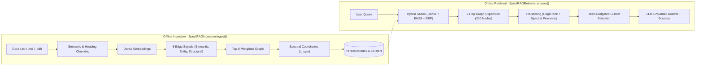
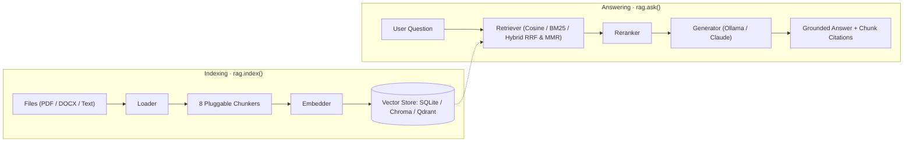
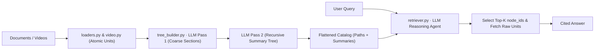
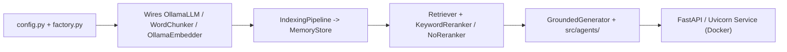
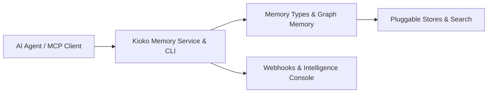

&lt;div align=&quot;center&quot;&gt;
  &lt;img src=&quot;https://capsule-render.vercel.app/api?type=waving&amp;color=0:0F172A,50:1E3A8A,100:0EA5E9&amp;height=210&amp;section=header&amp;text=Kumar%20Nishant&amp;fontSize=56&amp;fontColor=FFFFFF&amp;fontAlignY=38&amp;desc=Senior%20ML%20Engineer%20%7C%20AI%20Agent%20Specialist%20%7C%20AI%20Team%20Lead&amp;descAlignY=60&amp;descSize=18&amp;animation=fadeIn&quot; width=&quot;100%&quot; alt=&quot;Kumar Nishant Header Banner&quot; /&gt;
&lt;/div&gt;

&lt;p align=&quot;center&quot;&gt;
  &lt;a href=&quot;https://github.com/aion7891&quot;&gt;
    &lt;img src=&quot;https://readme-typing-svg.demolab.com?font=Fira+Code&amp;weight=600&amp;size=19&amp;duration=3000&amp;pause=1000&amp;color=0EA5E9&amp;center=true&amp;vCenter=true&amp;width=760&amp;lines=10%2B+Years+Building+Production+AI+%26+Enterprise+ML+Systems;Multi-Agent+Orchestration+%7C+MCP+Protocol+%7C+AWS+Bedrock;Graph+RAG+%7C+Vectorless+RAG+%7C+Long-Term+Agentic+Memory;Leading+Enterprise+AI+Teams+for+Fortune+500+Scale&quot; alt=&quot;Typing SVG&quot; /&gt;
  &lt;/a&gt;
&lt;/p&gt;

&lt;p align=&quot;center&quot;&gt;
  &lt;a href=&quot;mailto:knish5790@gmail.com&quot;&gt;&lt;img src=&quot;https://img.shields.io/badge/Email-knish5790%40gmail.com-EA4335?style=for-the-badge&amp;logo=gmail&amp;logoColor=white&quot; alt=&quot;Email&quot; /&gt;&lt;/a&gt;
  &lt;a href=&quot;https://github.com/aion7891&quot;&gt;&lt;img src=&quot;https://img.shields.io/badge/GitHub-aion7891-181717?style=for-the-badge&amp;logo=github&amp;logoColor=white&quot; alt=&quot;GitHub&quot; /&gt;&lt;/a&gt;
  &lt;img src=&quot;https://img.shields.io/badge/Location-Pune%2C%20India-0F172A?style=for-the-badge&amp;logo=googlemaps&amp;logoColor=white&quot; alt=&quot;Location&quot; /&gt;
  &lt;img src=&quot;https://komarev.com/ghpvc/?username=aion7891&amp;label=PROFILE%20VIEWS&amp;color=0ea5e9&amp;style=for-the-badge&quot; alt=&quot;Profile Views&quot; /&gt;
&lt;/p&gt;

---

## 👨‍💻 About Me

```python
class SeniorMLEngineer:
    def __init__(self):
        self.name = "Kumar Nishant"
        self.role = "Senior Data Scientist (MLE) & AI Team Lead @ Demandbase"
        self.experience = "10+ Years in Production AI, ML & Data Systems"
        self.location = "Pune, India"
        self.specialties = [
            "Multi-Agent Orchestration (A2A, LangGraph, LangChain)",
            "Model Context Protocol (MCP) & Tool Discovery",
            "Graph-Augmented, Hybrid & Vectorless RAG Systems",
            "Enterprise LLM Frameworks (AWS Bedrock, Claude, Llama, GPT)",
            "Long-Term Agentic Memory & Production MLOps",
        ]

    def current_focus(self):
        return [
            "Building open-source RAG & agent memory engines (SpectraFuse, rag-titan, Kioko)",
            "Scaling multi-agent workflows with 95%+ reliability & 99.5% uptime",
            "Researching spectral graph retrieval & reasoning-driven vectorless RAG",
        ]

    def leadership(self):
        return "Leading 5+ ML engineers delivering enterprise AI for Fortune 500 clients"
```

---

## 🛠️ Tech Arsenal

&lt;details open&gt;
&lt;summary&gt;&lt;strong&gt;🤖 AI / ML &amp; Agentic Systems&lt;/strong&gt;&lt;/summary&gt;
&lt;br /&gt;


&lt;/details&gt;

&lt;details open&gt;
&lt;summary&gt;&lt;strong&gt;☁️ Cloud, MLOps &amp; Infrastructure&lt;/strong&gt;&lt;/summary&gt;
&lt;br /&gt;


&lt;/details&gt;

&lt;details open&gt;
&lt;summary&gt;&lt;strong&gt;💻 Programming &amp; ML Frameworks&lt;/strong&gt;&lt;/summary&gt;
&lt;br /&gt;


&lt;/details&gt;

&lt;details open&gt;
&lt;summary&gt;&lt;strong&gt;📊 Data, Search &amp; Observability&lt;/strong&gt;&lt;/summary&gt;
&lt;br /&gt;


&lt;/details&gt;

&lt;details&gt;
&lt;summary&gt;&lt;strong&gt;🧱 Software Engineering Practices&lt;/strong&gt;&lt;/summary&gt;
&lt;br /&gt;


&lt;/details&gt;

---

## 🚀 Open-Source Work & Individual Architecture Flows

A showcase of my public repositories with the end-to-end execution flow behind each system.

### 1. [SpectraFuse](https://github.com/aion7891/SpectraFuse) — Spectral Graph-Augmented Multi-Hop RAG
   

Independent Python implementation inspired by *SpectRAG* (`arXiv:2610.36991`), combining multi-signal graph construction, normalized Laplacian spectral coordinates, PageRank re-scoring, and token-budgeted context selection for multi-hop RAG (`v0.2.0`).



---

### 2. [rag-titan](https://github.com/aion7891/rag-titan) — Swiss Army Knife for Local & Cloud RAG
   

A unified Python RAG library (`v0.11.0`) supporting multiple RAG strategies (`simple`, `adaptive`), 8 chunkers, hybrid RRF/MMR retrieval, and 100% local execution with Ollama or cloud inference with Claude.



---

### 3. [vectorless-rag-lite](https://github.com/aion7891/vectorless-rag-lite) — Reasoning-Based Tree RAG (`novector`)


Minimal, from-scratch vectorless RAG for documents and videos. Replaces vector embeddings and cosine similarity with a hierarchical semantic summary tree navigated by an LLM reasoning agent.



---

### 4. [agent-core-lab](https://github.com/aion7891/agent-core-lab) — Modular Core AI Agent & RAG Service


A containerized laboratory for building core AI agents and grounded RAG pipelines from first principles using a clean factory architecture.



---

### 5. [kioko-docs](https://github.com/aion7891/kioko-docs) — Kioko: Long-Term Memory for AI Agents


Published documentation portal for **Kioko**, covering agent memory types, graph memory, MCP integration, pluggable stores, CLI, console, webhooks, and deployment cookbooks.



---

### 6. Labs & In-Progress Builds
| Repository | Focus | Current State |
|---|---|---|
| [**base-core**](https://github.com/aion7891/base-core) | Hand-built ML utility core (`Rescale.scale_live` min-max scaler on NumPy/Pandas) | Core logic utility |
| [**rex-intelligence**](https://github.com/aion7891/rex-intelligence) | Multi-agent chatbot system to streamline user order requests | Initial architecture scaffold |

---

## 💼 Work History & Enterprise Impact

### Senior Data Scientist (MLE) & AI Team Lead — **Demandbase**
`01/2020 – Present` · `Pune, India`

* **Agent Platform Development:** Built and productionized enterprise AI agents using **AWS Bedrock** (Claude, Llama) for automated IT product classification and budget prediction; designed multi-agent orchestration managing specialized sub-agents with **95% reliability**; built LangGraph/LangChain memory components improving context retention by **40%**.
* **LLM Framework & Infrastructure:** Architected large-scale **BERT** classification models achieving **92% F1 score** for IT product identification; built production **MCP (Model Context Protocol)** client systems for server testing and tool discovery; implemented CI/CD MLOps pipelines reducing deployment time from **weeks to hours**; delivered ensemble IT budget regression models (**R² = 0.87**).
* **Technical Leadership:** Leading an enterprise AI team of **5+ engineers** shipping production agent capabilities for **Fortune 500** companies; mentoring junior ML engineers and setting standards for code review, testing, and documentation.

### Data Analyst — **Capita IT (Ventura)**
`08/2015 – 01/2020` · `Pune, India`

* Developed foundational ML models and ETL data pipelines that evolved into enterprise AI solutions.
* Built automated standing data systems for the insurance domain using deep learning (**ANN**) achieving **91.4% accuracy**.
* Applied unsupervised learning (**K-means, DBSCAN, LDA**) for product usage segmentation and behavioral analysis.

---

## 🏗️ Flagship Enterprise Systems

| System | Architecture & Tech Stack | Measured Impact |
|---|---|---|
| **Enterprise AI Agent Platform** | Python, AWS Bedrock, LangChain, LangGraph, Docker, Kubernetes, A2A, MCP | **99.5% uptime** across distributed agent infrastructure serving **50+ enterprise clients**; cut manual IT analysis by **80%** |
| **Production LLM Framework** | BERT, Transformers, MLflow, Terraform, AWS EC2/EMR, Prometheus, Grafana | Unified API interface integrating multiple Bedrock models (GPT, Claude, Llama) with full production observability |
| **Agentic Memory Management System** | LangGraph, Vector Databases, Elasticsearch, RAG | Improved response accuracy by **35%** with scalable vector storage handling **10M+ document embeddings** |

---

## 🏆 Achievements, Certifications & Education

| Credential / Recognition | Organization / Institution | Details |
|---|---|---|
| **AWS Machine Learning Specialty** | Amazon Web Services | Industry Certification |
| **Advanced Deep Learning Specialization** | Deep Learning Certification | Specialization |
| **B.Tech in Computer Science (Honors)** | B.K. Birla Institute of Engineering & Technology, Pilani | 2010 – 2014 · 70.6% |
| **Technical Innovation Award** | Demandbase | Led enterprise AI agent platform reducing manual IT analysis by **80%** |
| **International Research Internship** | Polytech, Nantes, France | Selected for advanced AI research internship |
| **Team Excellence ("Pat on Back" ×2)** | Enterprise Recognition | Awarded twice for outstanding automation and AI implementation |

---

## 📈 GitHub Analytics

&lt;div align=&quot;center&quot;&gt;
  &lt;img src=&quot;https://github-readme-stats.vercel.app/api?username=aion7891&amp;show_icons=true&amp;theme=tokyonight&amp;hide_border=true&amp;bg_color=0F172A&amp;title_color=38BDF8&amp;icon_color=38BDF8&amp;text_color=E2E8F0&quot; height=&quot;165&quot; alt=&quot;Kumar Nishant GitHub Stats&quot; /&gt;
  &lt;img src=&quot;https://github-readme-stats.vercel.app/api/top-langs/?username=aion7891&amp;layout=compact&amp;theme=tokyonight&amp;hide_border=true&amp;bg_color=0F172A&amp;title_color=38BDF8&amp;text_color=E2E8F0&quot; height=&quot;165&quot; alt=&quot;Top Languages&quot; /&gt;
&lt;/div&gt;

&lt;br /&gt;

&lt;div align=&quot;center&quot;&gt;
  &lt;img src=&quot;https://streak-stats.demolab.com?user=aion7891&amp;theme=tokyonight&amp;hide_border=true&amp;background=0F172A&amp;ring=38BDF8&amp;fire=0EA5E9&amp;currStreakLabel=38BDF8&quot; alt=&quot;GitHub Streak Stats&quot; /&gt;
&lt;/div&gt;

---

## 🤝 Let's Connect

&lt;div align=&quot;center&quot;&gt;
  &lt;a href=&quot;mailto:knish5790@gmail.com&quot;&gt;
    &lt;img src=&quot;https://img.shields.io/badge/Gmail-knish5790%40gmail.com-EA4335?style=for-the-badge&amp;logo=gmail&amp;logoColor=white&quot; alt=&quot;Email Kumar Nishant&quot; /&gt;
  &lt;/a&gt;
  &lt;a href=&quot;https://github.com/aion7891&quot;&gt;
    &lt;img src=&quot;https://img.shields.io/badge/GitHub-aion7891-181717?style=for-the-badge&amp;logo=github&amp;logoColor=white&quot; alt=&quot;GitHub aion7891&quot; /&gt;
  &lt;/a&gt;
  &lt;a href=&quot;https://github.com/aion7891?tab=repositories&quot;&gt;
    &lt;img src=&quot;https://img.shields.io/badge/Explore-Repositories-0EA5E9?style=for-the-badge&amp;logo=git&amp;logoColor=white&quot; alt=&quot;Explore Repositories&quot; /&gt;
  &lt;/a&gt;

  &lt;br /&gt;&lt;br /&gt;

  *Architecting production AI agents, graph-augmented retrieval, and long-term agent memory.*

  **Thanks for visiting! Star any repo if you find it useful.**
&lt;/div&gt;

&lt;div align=&quot;center&quot;&gt;
  &lt;img src=&quot;https://capsule-render.vercel.app/api?type=waving&amp;color=0:0EA5E9,50:1E3A8A,100:0F172A&amp;height=95&amp;section=footer&quot; width=&quot;100%&quot; alt=&quot;Footer Wave&quot; /&gt;
&lt;/div&gt;
